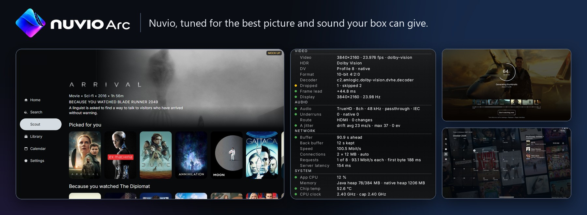
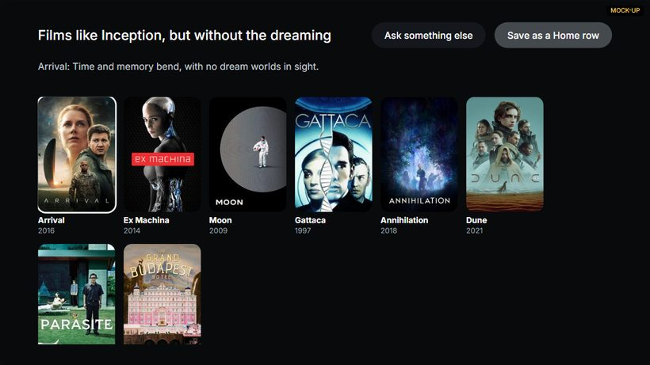
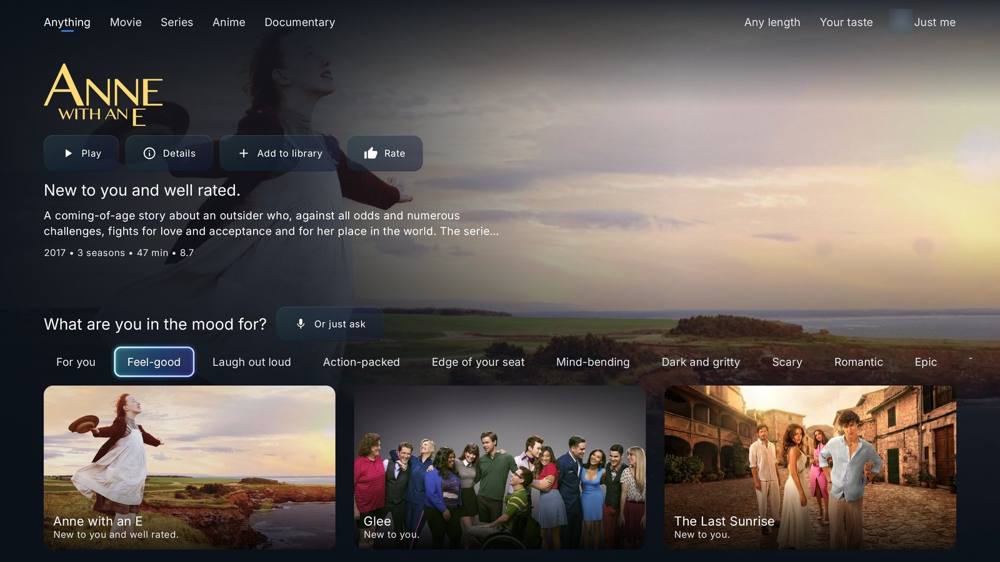
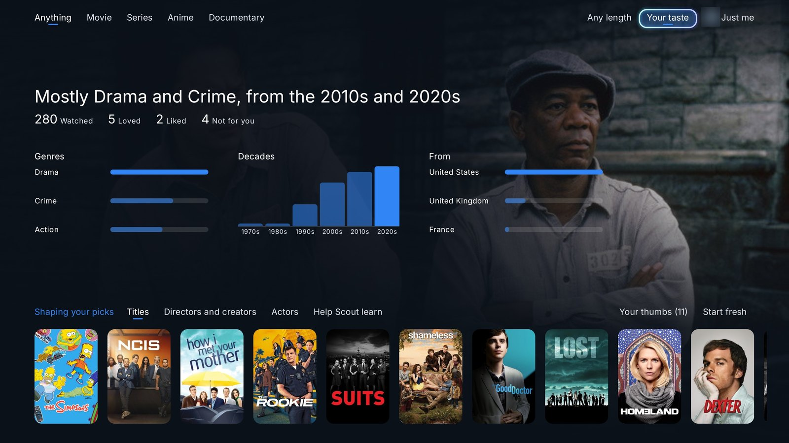
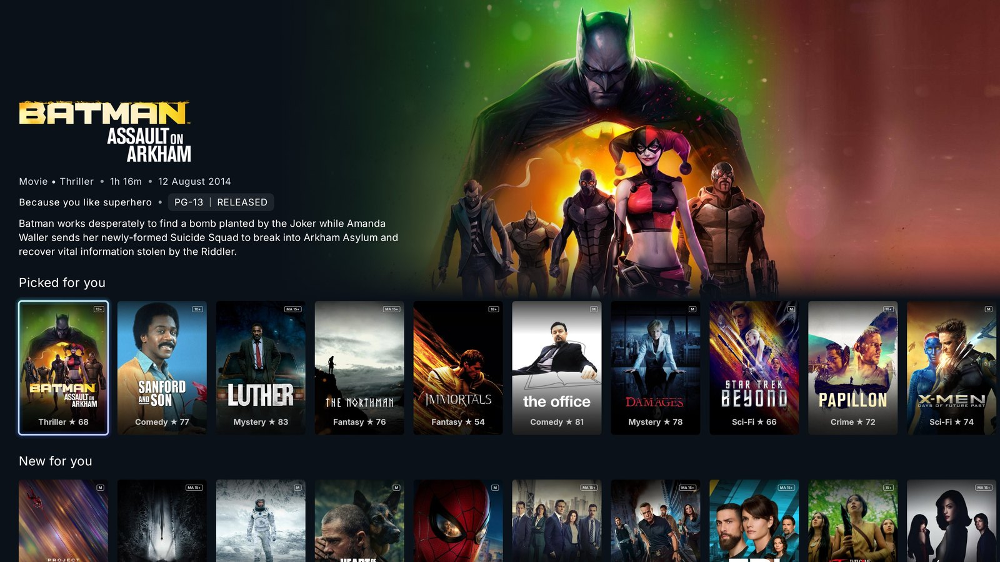
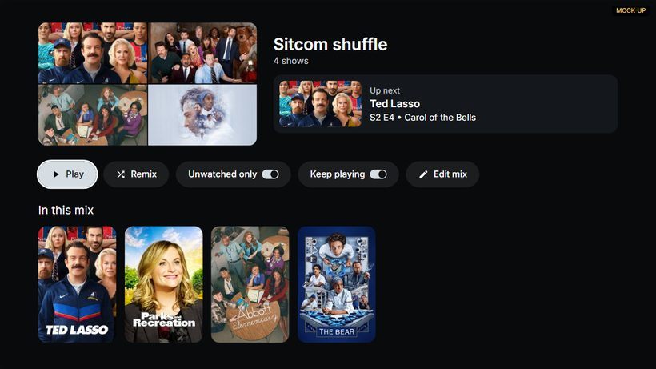
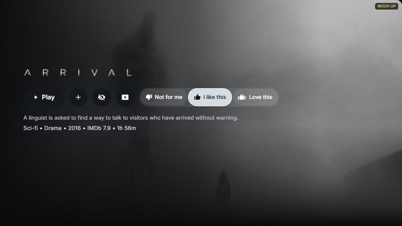
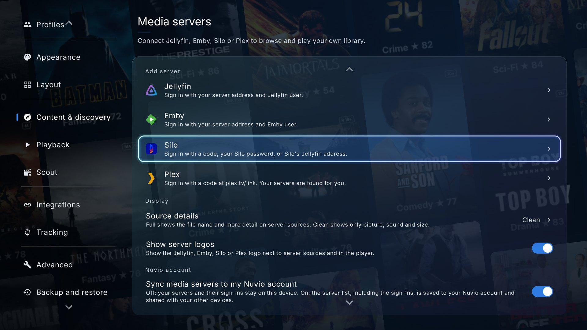
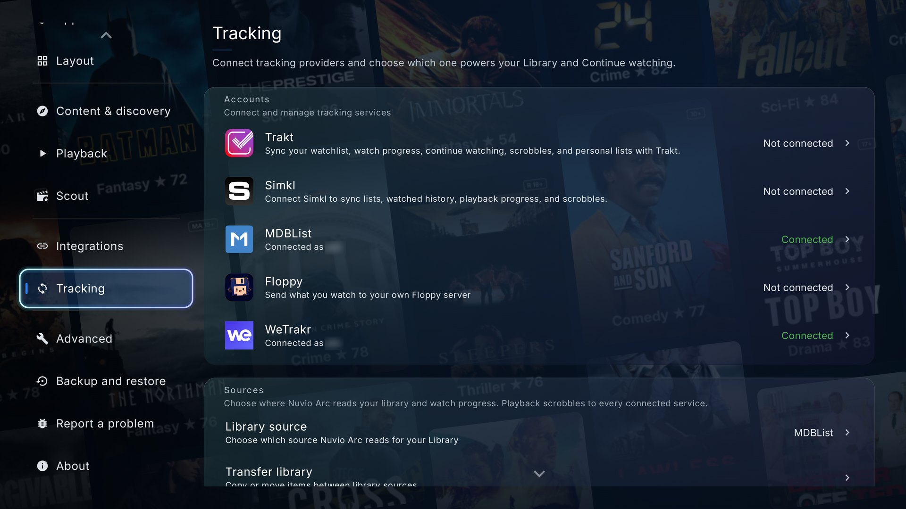

<p align="center">
  
</p>

<p align="center">
  <a href="https://github.com/ysosrs123/NuvioTV-Fork/releases/latest"></a>
  <a href="https://github.com/ysosrs123/NuvioTV-Fork/releases"></a>
  <a href="./LICENSE"></a>
  <a href="https://www.reddit.com/r/NuvioForks/"></a>
</p>

<p align="center">
  <a href="#install"><b>Install</b></a> &nbsp;·&nbsp;
  <a href="#what-it-adds"><b>What it adds</b></a> &nbsp;·&nbsp;
  <a href="#a-look-around"><b>A look around</b></a> &nbsp;·&nbsp;
  <a href="#support-and-contact"><b>Support</b></a>
</p>

**Nuvio Arc** is my hobby fork of [NuvioTV](https://github.com/NuvioMedia/NuvioTV) for Android TV: a test bench for new ideas, built around picture quality, lossless sound, your own libraries and finding something to watch. It isn't a competitor to Nuvio and isn't meant to replace it. It's for people who like Nuvio and are happy to try new, largely untested features. If you want the dependable everyday app, use the official Nuvio.

Nuvio Arc is a media player. It doesn't host, provide or link to any content. You add your own sources, and you're responsible for making sure you're allowed to play what you add. See the [disclaimer](#disclaimer).

## Install

It installs next to the official Nuvio, and tells you when a new release is out.

| Your box | [Downloader](https://www.aftvnews.com/downloader/) code | Direct download |
|---|:--:|---|
| **32-bit:** Fire TV Stick, Chromecast with Google TV, Xiaomi, Onn and many other Google TV boxes | **`2764920`** | [32-bit APK](https://github.com/ysosrs123/NuvioTV-Fork/releases/latest/download/app-full-armeabi-v7a-release.apk) |
| **64-bit:** Nvidia Shield, Ugoos | **`4993875`** | [64-bit APK](https://github.com/ysosrs123/NuvioTV-Fork/releases/latest/download/app-full-arm64-v8a-release.apk) |

1. Install **Downloader** by AFTVnews from your box's app store.
2. Allow it to install unknown apps in your box's settings.
3. Open Downloader, type the code and press Go.
4. Press Install when the download finishes.

Not sure which one? Many boxes run a 32-bit system even with a 64-bit chip. Try 64-bit first. If it says the app isn't compatible, use 32-bit.

## Dolby Vision FEL on the Fire TV Cube 3

Nuvio Arc can play Dolby Vision Profile 7 FEL with its full enhancement layer on a Fire TV Cube 3. The
box's own Dolby Vision core combines the base layer and the enhancement layer, with no conversion to
Profile 8.1. This is experimental. It needs all of the following:

1. **A Fire TV Cube 3rd generation** (board `gazelle`). Tested on Fire OS 7.7.1.7. Other Fire TV
   devices and other boxes can't use it.
2. **Root** on the Cube.
3. **signde's Fire TV AV module** ([signde/vlc-fel-android](https://github.com/signde/vlc-fel-android)),
   installed through root. It loads the `dvfel` kernel helper (version **2026.10.25.2 or newer**), lets
   apps open `/dev/dvfel` and sets the `debug.dvfp.*` player properties. Nuvio never installs or loads
   anything with root itself.
4. **The FEL APK**:
   [app-full-fel-armeabi-v7a-release.apk](https://github.com/ysosrs123/NuvioTV-Fork/releases/latest/download/app-full-fel-armeabi-v7a-release.apk).
   Only this APK contains `libdvfelplay`, the FEL helper; the normal 32-bit and 64-bit APKs don't. It
   installs over the normal Nuvio Arc and keeps your settings. Its in-app updates stay on the FEL APK.
5. **ExoPlayer** as the player, a **Dolby Vision TV**, and Profile 7 files that have an enhancement layer
   and aren't encrypted.

Then open **Settings → Playback → Dolby Vision handling** and choose **Native FEL (Fire TV Cube 3)**. The
option only appears in the FEL APK on a Cube 3. If it says *Fire TV AV module not detected*, the module
isn't loaded or set up. You can check it with adb:

```bash
adb shell cat /sys/module/dvfel/version
```

```bash
adb shell getprop debug.dvfp.hold_images
```

The first should print 2026.10.25.2 or later, the second `1`. While a film plays, the Stats panel shows
`RPU + BL + EL` next to the Dolby Vision mode when FEL is composed. Whenever something is missing, or a
stream can't take the FEL path, it plays as it would with **Auto**.

## What it adds

 Only in Arc

<p></p>

Meet Scout, your personal film curator. It's on for everyone and doesn't need an external add-on. Scout is experimental for now, so you may run into some bugs or slow spots. It's being actively developed, and its picks get better over time as it learns what you like.

<table>
<tr><td width="33%" valign="top"><br><b>Just ask for it</b><br><sub>"Films like Inception, but without the dreaming"</sub></td><td width="33%" valign="top"><br><b>What should we watch tonight?</b><br><sub>Picks that suit everyone on the couch, and why</sub></td><td width="33%" valign="top"><br><b>It gets to know you</b><br><sub>See what it has learned about what you like</sub></td></tr>
<tr><td width="33%" valign="top"><br><b>Something to watch, right on Home</b><br><sub>New picks on Home each day</sub></td><td width="33%" valign="top"><br><b>Can't decide? Mix it up</b><br><sub>Random episodes from the shows you choose</sub></td><td width="33%" valign="top"><br><b>Tell it what you think</b><br><sub>Love it, like it or not for me, and your picks follow</sub></td></tr>
</table>

<table>
<tr><td width="50%" valign="top"><b>Picks that know you, made on your box</b> <br>Scout learns from what you really do on each profile: what you finish, rewatch, stop early and rate. Your history stays on the box, and picks need no account, key or external add-on.</td><td width="50%" valign="top"><b>It tells you why</b> <br>Each pick comes with a plain reason, like "Because you love Villeneuve and slow sci-fi".</td></tr>
<tr><td width="50%" valign="top"><b>All your tastes, not an average</b> <br>Slow sci-fi and comfort sitcoms get their own named rows, not one blended row.</td><td width="50%" valign="top"><b>A few presses with the remote</b> <br>Rest on a mood and the page changes. Set how long you've got and who's in the room, with no typing. Add everyone on the couch and the picks must suit you all.</td></tr>
<tr><td width="50%" valign="top"><b>Ask for anything, with your own AI key</b> <br>Speak into the remote, type or use your phone, in any language: "films like Inception, but without the dreaming". You get normal title cards, each with a reason, and an answer opens like a title page.</td><td width="50%" valign="top"><b>Your key, your choice</b> <br>Gemini, Groq, OpenAI, Claude or any service with the OpenAI format. Paste it on your phone; it stays encrypted on the box. You see what gets sent before anything goes.</td></tr>
<tr><td width="50%" valign="top"><b>AI that can't make titles up</b> <br>It only reorders real titles Scout has already found, so every pick exists. Read and edit your taste summary, like "no jump scares".</td><td width="50%" valign="top"><b>A sentence becomes a Home row</b> <br>Save any answer as a row. It refreshes itself about once a week with your key and moves like any other row.</td></tr>
</table>

<p></p>

<table>
<tr><td colspan="1" valign="top"><b>More filters</b> <br>Browse by mood, decade, country, region, language, length, theme and acclaim.</td><td colspan="1" valign="top"><b>Mixes</b> <br>Random episodes across several shows you pick, with their own artwork on Home. Remix, Unwatched only and Keep playing are one press away.</td><td colspan="1" valign="top"><b>Love it, like it, not for me</b> <br>Rate titles in one press and your picks follow. One switch turns it all off.</td></tr>
<tr><td colspan="1" valign="top"><b>Your taste</b> <br>One plain sentence about what you watch, and the titles behind it. Stays on your box.</td><td colspan="1" valign="top"><b>Complete series and Family night</b> <br>Only shows that have ended, or PG and under with no horror, no kids profile needed.</td><td colspan="1" valign="top"><b>Save as a Home row</b> <br>Keep any set of picks as a row that keeps finding new titles.</td></tr>
<tr><td colspan="1" valign="top"><b>New for you and Trending for you</b> <br>What's just out and what's big this week, sorted by your taste, not by popularity.</td><td colspan="1" valign="top"><b>Refine with one press</b> <br>Less violent, Older, Newer or Something lighter on any Ask answer.</td><td colspan="1" valign="top"><b>Pick five to get started</b> <br>A new profile chooses five posters it loves, and Scout has something to work with straight away.</td></tr>
</table>

<p></p>

<table>
<tr><td colspan="1" valign="top"><b>Own surround engine</b> <br>Packs TrueHD, DTS-HD MA and DTS:X for HDMI itself, and recovers after input switches.</td><td colspan="1" valign="top"><b>Auto surround</b> <br>Picks passthrough formats from what your TV and receiver report, or set each yourself.</td><td colspan="1" valign="top"><b>Soundbar on your TV</b> <br>Arc on a TV with a soundbar on ARC: formats it can't take become Dolby Digital 5.1, and DTS-HD can go through the TV.</td></tr>
<tr><td colspan="1" valign="top"><b>Surround kept when decoding</b><br>Formats your gear refuses decode to 5.1 or AC-3 instead of stereo, and DTS-HD that keeps failing is decoded rather than left silent.</td><td colspan="1" valign="top"><b>Night mode and Dialogue boost</b><br>Night mode on a remote button, Strong also lowers the loudest moments, and speech goes up to +12 dB.</td><td colspan="1" valign="top"><b>Dolby Vision Auto</b><br>Converts Profile 7 whenever the screen does Dolby Vision, even if the box doesn't list a Profile 8 decoder.</td></tr>
<tr><td colspan="1" valign="top"><b>Native Dolby Vision FEL</b> <br>Full Profile 7 dual layer on a Ugoos AM9 Pro with a test kernel (not available yet).</td><td colspan="1" valign="top"><b>Precise frame rates</b><br>On TVs with QMS, picks a rate the TV can switch to without the black screen.</td><td colspan="1" valign="top"><b>Old formats</b><br>Big AVI files and XviD, DivX and VC-1 fixes; WMV and 10-bit H.264 open in MPV by themselves.</td></tr>
</table>

<p></p>

<table>
<tr><td colspan="1" valign="top"><b>Seek thumbnails</b> <br>Hold left or right for a picture strip, even on a 4K Dolby Vision film. On ExoPlayer.</td><td colspan="1" valign="top"><b>Thumbnails before the film</b> <br>Have them ready before it starts, with a choice of Full, Faster or Fastest wait.</td><td colspan="1" valign="top"><b>Thumbnails from a copy</b> <br>Makes 4K thumbnails from a lighter copy in your sources, on the hardware decoder.</td></tr>
<tr><td colspan="1" valign="top"><b>Your server's own thumbnails</b> <br>When Jellyfin, Emby, Silo or Plex has already made thumbnails, the player uses those.</td><td colspan="1" valign="top"><b>Seeking your way</b> <br>Gentle, Balanced, Fast or Confirm with OK.</td><td colspan="1" valign="top"><b>Remote buttons</b> <br>Give any button a press job and a hold job in the player.</td></tr>
<tr><td colspan="1" valign="top"><b>Player button editor</b> <br>Show, hide and move the player's buttons, with icons or labels.</td><td colspan="1" valign="top"><b>Chapters from more files</b><br>MP4 and media-server chapters too, recaps left out, with a remote button.</td><td colspan="1" valign="top"><b>Subtitle look</b> <br>Choice of fonts, outline size and a separate shadow, on both players.</td></tr>
<tr><td colspan="1" valign="top"><b>Subtitle languages</b><br>A third preferred language, and the panel opens language first.</td><td colspan="1" valign="top"><b>Image subtitle size</b> <br>Picture subtitles (PGS, VobSub) get their own size.</td><td colspan="1" valign="top"><b>Stats panel</b> <br>The audio path, Dolby Vision layers, connections, requests and server replies, as your film plays.</td></tr>
<tr><td colspan="3" valign="top"><b>IMDb trailers</b> <br>Choose IMDb as the trailer source: looked up by IMDb id, up to 4K.</td></tr>
</table>

<p></p>

<table><tr><td align="center"><br><sub>Plex</sub></td><td align="center"><br><sub>Jellyfin</sub></td><td align="center"><br><sub>Emby</sub></td><td align="center"><br><sub>Silo</sub></td><td align="center"><br><sub>WeTrakr</sub></td><td align="center"><br><sub>Floppy</sub></td><td align="center"><br><sub>Trakt</sub></td><td align="center"><br><sub>Simkl</sub></td><td align="center"><br><sub>MDBList</sub></td></tr></table>

<table>
<tr><td colspan="1" valign="top"><b>Plex</b> <br>Sign in with a code; libraries on Home, in Search and as sources.</td><td colspan="1" valign="top"><b>Silo</b> <br>Own sign-in, profile picker and your Silo Home rows.</td><td colspan="1" valign="top"><b>Jellyfin and Emby extras</b> <br>Second addresses, your own server names, Quick Connect, and skip intro from the server's own markers.</td></tr>
<tr><td colspan="1" valign="top"><b>Your own server's certificate</b> <br>A self-signed home server can be trusted once, with its details shown first.</td><td colspan="1" valign="top"><b>Server sign-ins stay here</b><br>They stay on the box unless you switch on account sync.</td><td colspan="1" valign="top"><b>Big library browsing</b> <br>Genres, A to Z, letter jump, Unwatched and Folders from genres.</td></tr>
<tr><td colspan="1" valign="top"><b>All debrid at once</b><br>Real-Debrid, AllDebrid, TorBox and Premiumize together; uncached picks move to the next.</td><td colspan="1" valign="top"><b>WeTrakr and Floppy</b> <br>Two more trackers, next to Trakt, Simkl and MDBList. Mark as unwatched reaches Floppy too.</td><td colspan="1" valign="top"><b>Tracker lists on Home</b> <br>Any list from WeTrakr, Trakt, MDBList or Simkl as its own row, films and shows together.</td></tr>
<tr><td colspan="2" valign="top"><b>Transfer library</b> <br>Copy or move your library between services, with a preview first.</td><td colspan="1" valign="top"><b>Best quality picks</b> <br>TRaSH Guides release tiers decide what auto-play picks and what sorts first.</td></tr>
</table>

<p></p>

<table>
<tr><td colspan="1" valign="top"><b>Automatic speed-up</b> <br>Adds downloads when a film needs them and remembers each server.</td><td colspan="1" valign="top"><b>Dead links skipped</b> <br>A dead link moves on to the next ready source.</td><td colspan="1" valign="top"><b>Search before Play</b> <br>Finds and ranks sources while you browse, so Play starts sooner. Off to start.</td></tr>
<tr><td colspan="1" valign="top"><b>Buffers sized to your box</b> <br>One Buffer ahead setting, sized from your memory, with honest numbers.</td><td colspan="1" valign="top"><b>Encrypted DNS</b> <br>Private address look-ups for add-ons, debrid, servers and ExoPlayer, through Cloudflare, Google, Quad9, AdGuard or your own.</td><td colspan="1" valign="top"><b>Polite to TorBox</b> <br>Thumbnails wait near TorBox's limit, and a refused source moves straight on.</td></tr>
<tr><td colspan="1" valign="top"><b>Device assessment</b> <br>Measures your box and link, suggests settings, applies them in one press.</td><td colspan="1" valign="top"><b>Format check</b> <br>Plays tiny test clips to find which video, HDR and audio formats your box really handles, then suggests settings. Test any clip again from the results.</td><td colspan="1" valign="top"><b>Smarter speed test</b> <br>Tries connection and piece sizes on your last stream and says what to use.</td></tr>
<tr><td colspan="2" valign="top"><b>Add-on health</b> <br>Marks each add-on and debrid service OK, Slow or Down.</td><td colspan="1" valign="top"><b>Add-on timeout</b> <br>Give a slow add-on longer to answer.</td></tr>
</table>

<p></p>

<table>
<tr><td colspan="1" valign="top"><b>Watch party</b><br>No account needed, surround left alone, plus cross-play with Nuvio app users (experimental).</td><td colspan="1" valign="top"><b>Watch party friends</b> <br>Add a friend once and invite them later without a code, with over 140 avatars.</td><td colspan="1" valign="top"><b>Calendar</b> <br>Next episodes, film dates and new-episode reminders, in your own time zone.</td></tr>
<tr><td colspan="1" valign="top"><b>Coming up on Home</b><br>A row of new and upcoming episodes and films from your Calendar.</td><td colspan="1" valign="top"><b>Episodes left</b> <br>Show cards in Continue watching can show how many aired episodes are left.</td><td colspan="1" valign="top"><b>Parental guide</b> <br>IMDb's guide on the details page, above Cast, worst first.</td></tr>
<tr><td colspan="1" valign="top"><b>Backup and restore</b><br>Save your profiles and settings to a file and bring them back after a wipe or on a new box. Passwords are only included with a PIN.</td><td colspan="1" valign="top"><b>Report a problem</b><br>Tell me what went wrong from inside Arc. You see exactly what will be sent before anything goes, with your private details taken out first.</td><td colspan="1" valign="top"><b>Record a problem</b> <br>For faults that come and go: up to 30 minutes of playback numbers, never the sound or picture, with a mark at each moment it goes wrong.</td></tr>
</table>

<p></p>

<table>
<tr><td colspan="1" valign="top"><b>Nuvio V2 look</b> <br>Cinematic Glass or Pure Liquid Dark, Control Deck or Invisible player controls, floating sidebar or top menu.</td><td colspan="1" valign="top"><b>Arc look</b> <br>Logo in your theme colours, intro with sound, 16 icon colours, card and banner looks, launcher icon pack.</td><td colspan="1" valign="top"><b>Interface scale</b> <br>Shrink or enlarge the whole interface, or let the app size it.</td></tr>
<tr><td colspan="2" valign="top"><b>Watched titles on Home</b> <br>Show, Dim or Hide what you've already watched.</td><td colspan="1" valign="top"><b>Keep it fresh</b> <br>Also keep Plan to watch and part-watched titles out of Home rows and the banner.</td></tr>
</table>

The details, more screenshots and what's been removed are on the **[full feature page](docs/FEATURES.md)**.

## A look around

<table>
<tr>
<td width="50%"><br><b>Your own media server</b></td>
<td width="50%"><br><b>Calendar</b></td>
</tr>
<tr>
<td><br><b>All your trackers</b></td>
<td><br><b>Remote buttons</b></td>
</tr>
</table>

## Support and contact

Nuvio Arc is a one-person hobby, with no Discord and no support team.

**The best way to report a problem is from inside Arc.** Press Report in the player, or on the loading and error screens, or open Report a problem in Settings. You see exactly what will be sent before you press Send, links, keys and addresses are taken out first, and you get a short code for your report. For faults that come and go, Record a problem keeps up to 30 minutes of playback numbers while you mark the moments it goes wrong. You can send ideas the same way. Reports go to a private inbox for this project, never to the official team.

Can't use that, or want to talk it through? Open an [Issue](https://github.com/ysosrs123/NuvioTV-Fork/issues) with your box, the Arc version (Settings > About) and the kind of source and format you were playing (for example 4K Dolby Vision from a media server), or chat with other users at [r/NuvioForks](https://www.reddit.com/r/NuvioForks/). No promises on replies or fixes.

Nuvio Arc is not affiliated with or endorsed by the NuvioTV project. **Please don't report problems from this build to the official Nuvio GitHub or Discord.** They can't help with changes they didn't make.

## Supporting Nuvio

Nuvio Arc is completely free, and I don't take donations. It's built on Nuvio, so if you enjoy it, please support the Nuvio team at [nuvio.tv/support](https://nuvio.tv/support). Every supporter membership and donation in the app goes straight to the official team, and none of it comes to me.

## Disclaimer

**What Nuvio Arc is.** Nuvio Arc is a media player and library browser. It comes with no films, shows, channels, streams, playlists or stream add-ons, and I don't host, index, provide or link to any. As installed it shows catalogue information (titles, artwork, ratings, subtitles) from public metadata services, and it plays nothing until you connect a source of your own.

**Your sources.** Everything you play comes from something you chose to connect: your own media server, an account you hold with another service, or an add-on or extension you installed. Those are made and run by other people. I don't control them, can't see what they offer, don't check or endorse them, and am not responsible for what they return. Questions about what a source provides belong with that source.

**Your responsibility.** You are responsible for making sure you have the right to play what you play, and that your use follows the law where you live and the terms of the services you use. Don't use Nuvio Arc to get content you aren't entitled to. Peer-to-peer playback is off until you turn it on, and it shows your address to other peers.

**No help with sources.** I can't help with finding content, add-ons or providers. Issues that ask for or share links to unauthorised content are closed and removed.

**Copyright concerns.** This repository holds the app's source code and its own artwork and screenshots. If you believe something here infringes your rights, please write to me first at [arc_issues@mailbox.org](mailto:arc_issues@mailbox.org), naming the file or link, and I will deal with it promptly.

**Names and logos.** Service names and logos belong to their owners and only show which service the app can connect to. Nuvio Arc is not affiliated with, endorsed by or certified by any of them, or by the NuvioTV project. This product uses the TMDB API but is not endorsed or certified by TMDB.

**No warranty.** Nuvio Arc is provided as is, without warranty of any kind, under the [GNU General Public License v3.0](./LICENSE).

## Licence

This is a modified version of [NuvioTV](https://github.com/NuvioMedia/NuvioTV), changed by ysosrs123
from July 2026 onwards. Every change is in this repository's history on top of the official release
it builds on (currently 1.1.0). It is licensed under the
[GNU General Public License v3.0](./LICENSE), the same as NuvioTV. All upstream copyright notices,
licence headers and author attributions are kept. Full credit to the NuvioTV maintainers and contributors.

Parts from other projects keep their own licences:
- TrueHD MAT packing and the downmix path: ported from Kodi (GPL-2.0-or-later), see
  `ffmpeg-decoder-downmix/NOTICE.md`.
- Audio passthrough engine: official pull request 3107 by halibiram, with ram130. Media servers:
  official pull request 3728 by tapframe.
- FFmpeg (LGPL-2.1-or-later): audio decoder built from FFmpeg 7.0.2, recipe in
  `.github/workflows/build-ffmpeg-decoder.yml`; headers only under `app/src/main/cpp/third_party/`.
- dav1d by VideoLAN and the dav1d authors (BSD-2-Clause) for software AV1 decoding, with
  cpu_features by Google (Apache-2.0).
- libdovi by quietvoid (MIT). Matroska extractor files from AndroidX Media3 (Apache-2.0), changed.
- libdvfelplay by Team CoreELEC, djnice and signde (GPL-2.0-or-later) for Dolby Vision Profile 7 FEL on the
  rooted Fire TV Cube 3: source in `third_party/libdvfelplay/` (signde/vlc-fel-android, tag
  v0.1.0-fc3-experimental, commit 58b7b69), built by `scripts/build-dvfelplay.sh`.
- Release group lists from TRaSH Guides (MIT).
- Fonts Atkinson Hyperlegible Next, Source Sans 3, and the subtitle fonts Roboto, Montserrat, Noto Sans and Asap Condensed (SIL Open Font License 1.1, texts in
  `app/src/main/assets/licenses/`).
- Watch party avatars: made with DiceBear and Twemoji, under CC BY 4.0, CC0 1.0 and the Bottts terms.
  They are credited in the app under Settings > About > Licenses & attribution and are not covered by the GPL.
- Calendar episode times come from TVmaze's schedule service and TheTVDB (metadata provided by TheTVDB),
  credited in the app under Settings > About > Licenses & attribution.
- Posters and artwork in the screenshots are catalogue artwork from TMDB and belong to their owners. They show the app's own pages only.
- Other service logos and names belong to their owners and only show which service the app connects to.
- Prebuilt libraries that come unchanged from the official app are covered by the official project's
  sources and notices.

This fork is not affiliated with or endorsed by the NuvioTV project or any of the services named.
