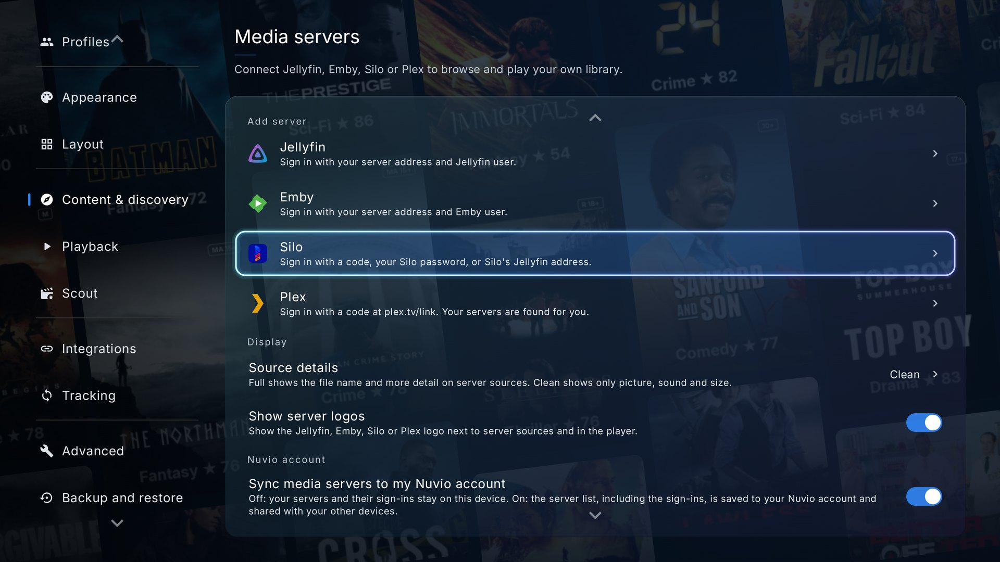
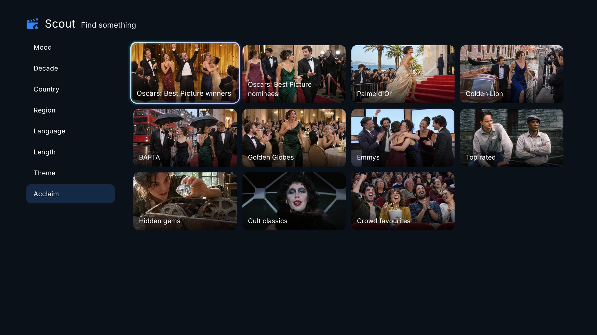
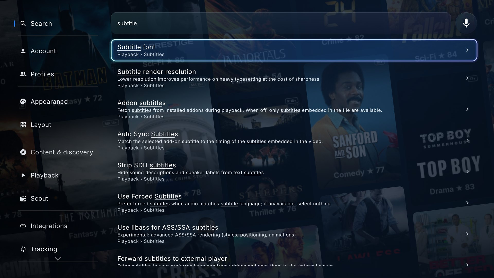
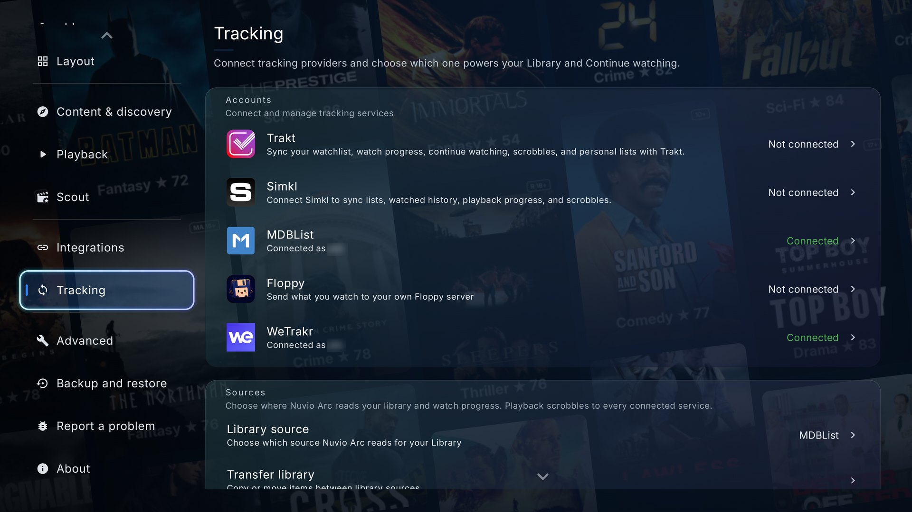
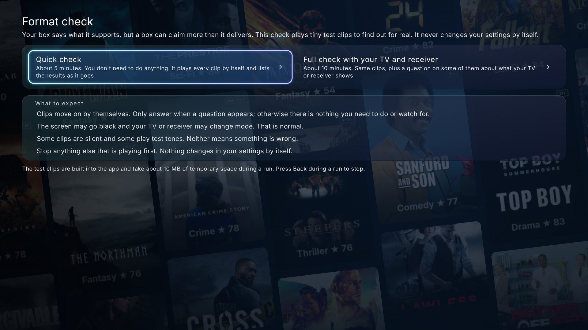
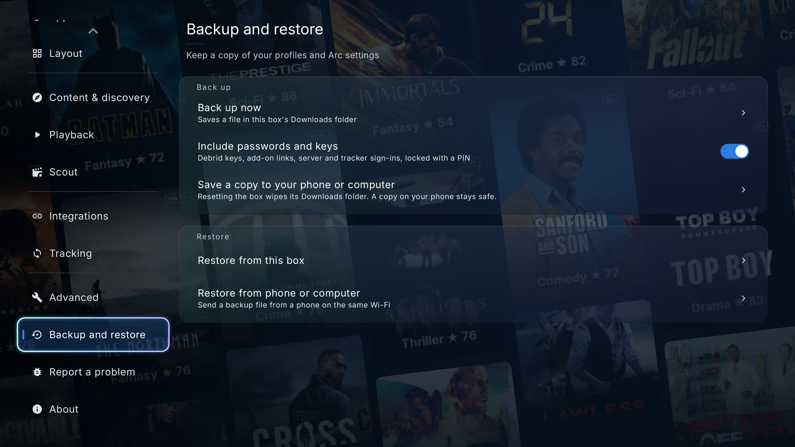
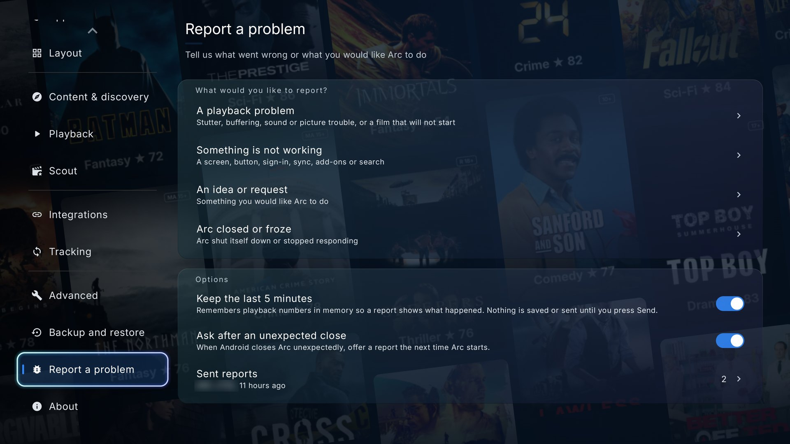

# Nuvio Arc: everything it adds

[Back to the main page](../README.md)

Optimisation and playback-quality work, most of it aimed at high-bitrate video and lossless audio, plus a few features I've always wanted in a TV player.

## Scout: your personal film curator

Built into Arc, with no website, external add-on or key to set up for the picks. Scout is experimental for now, so you may run into some bugs or slow spots. It's being actively developed, and its picks get better over time as it learns what you like.

- **Picks on Home** -- Picked for you, Because you watched and Hidden gems, built from what you watch and refreshed once a day.
- **The Scout page** -- artwork fills the screen and moods run along the page, so rest on one and the picks change, each with one line on why it's there. Choose what you're watching, how long you've got and who's in the room, with no typing. Anime gets its own moods, documentaries are picked by topic.
- **More filters** -- browse by mood, decade, country, region, language, length, theme and acclaim, including Oscar winners and other award lists.
- **Pick for everyone on the couch** -- add the other profiles on your box and the picks have to suit all of you. Family night stays at PG or under and leaves out horror.
- **Tune the picks with one press** -- Lighter, Darker, Newer, Older, Better rated, Hidden gems, International, or three more. Save what you like as a Home row and it keeps finding new titles.
- **Ask in your own words** -- speak into the remote, type or use your phone, in any language, with your own AI key (Gemini, Groq, OpenAI, Claude or any service with the OpenAI format). Your key stays encrypted on the box. Only your question, a short list of titles you liked, genres you leave out and the answer language are sent.
- **Mixes** -- random episodes across several shows, with a tile built from their pictures, on Home like any other row. The idea comes from TV Mix in Nuvio-ReSeq, thanks.
- **Love it, like it, not for me, and Your taste** -- rate titles in one press and your picks follow, and one switch turns it all off. Your taste shows one plain sentence about what you watch, and it all stays on the box.

## Picture and sound

- **Lossless audio you can trust** -- a surround engine that packs TrueHD, DTS-HD MA and DTS:X for
  HDMI itself, with an **Auto surround** mode that picks the formats from what your TV and receiver
  report. Or set it yourself with per-format passthrough switches (Dolby Digital, DD+, TrueHD, DTS,
  DTS-HD) phrased as questions about your receiver: switch off what
  your gear can't decode and Nuvio decodes just those in the app, with its own decoder, because some
  boxes ship a vendor DTS decoder that quietly folds 5.1 to stereo. It resists mid-film renegotiation
  dropping you to lossy without telling you, comes back after the TV switches input, plays DTS Express
  commentary tracks, and picks the lossless track so you don't start every film in the wrong audio.
- **Native Dolby Vision Profile 7, FEL and MEL** -- the full dual-layer signal decoded inside
  Nuvio on Android, enhancement layer included, the way a disc player does it. For now this needs a
  Ugoos AM9 Pro on Android 14 running my own test kernel, plus a Dolby Vision display. That kernel
  is not available yet; I plan to share it once it has had more testing. Stock firmware and other
  boxes can't do it, so there the mode simply behaves like Auto.
- **Dolby Vision Auto** -- Arc converts Profile 7 on every Dolby Vision TV by itself, including TVs with
  Android built in whose decoder claims it can play Profile 7 and then shows nothing. The Profile 7 and
  Profile 5 conversion itself comes from official Nuvio; Arc adds the Auto behaviour, no per-frame stutter
  and correct enhancement-layer handling for single-track files.
- **Playback that holds up** --
  - *Fewer stalls, less wasted bandwidth:* Arc keeps the pipeline properly fed and avoids downloading
    the same pieces twice, which mattered a lot on early builds. The official app has improved here too,
    and I haven't measured the two side by side. Buffers are sized from the
    memory your box really has, so a 2 GB box no longer chokes on its own buffer.
  - *Faster stream start:* pressing play opens the connection at the press. With **Search sources
    before Play** on (off by default) the app also searches and ranks sources while you browse.
  - *A dead link is not a dead end:* when a source fails at the start, the player moves on to the next
    ready one by itself, on ExoPlayer and MPV, and a dead server is noticed within seconds.
  - *Judder-free frame rates:* precise 23.976-vs-24 matching, 120 Hz for films on screens without
    24 Hz, and frames kept evenly spaced on the TV's refresh ticks.
  - *Old formats that play properly:* AVI, XviD, DivX, VC-1 and WMV, with frame rate matching, and
    non-faststart MP4s that seek without stalling.
  - *AV1 on boxes without an AV1 chip,* decoded with dav1d.
- **Automatic speed-up** -- for films that keep buffering from far-away servers. On by default, nothing to
  tune: the bigger download window is in official Nuvio too, and on boxes with enough memory Arc adds extra
  downloads when a film needs them and hands them back when it doesn't. It remembers what each server
  can do, starts heavy 4K films on more than one download and gets the buffer back quickly after a seek
  or a stall. Measured on a Fire TV Stick 4K Max from a server on the other side of the world: 28 Mbit/s
  became 86 Mbit/s and 23 stops in three minutes became 6.
- **Trailers that start quickly** -- with Trailer source set to IMDb, the trailer is found in under a
  second, plays at the best resolution IMDb has (up to 4K) and starts after a short buffer.

## Seek thumbnails and subtitles

- **Seek thumbnails made by the app itself** -- hold left or right and a strip of pictures shows
  exactly where you will land, from an old AVI to a 4K Dolby Vision film. On by default on boxes with 3 GB of memory or more. A new
  thumbnail every 10 seconds, sharp enough to read the scene, ready straight away for anything
  you've played before, and carried over to another release of the same film. When your Jellyfin,
  Emby, Silo or Plex server has made its own thumbnails, the player uses those. Turn on **Thumbnails from a
  copy** and a 4K film gets its thumbnails from a 1080p copy in your sources, about five times less to
  download, so even a Fire TV Stick can make them while the film plays. No third-party service, no API
  key, nothing uploaded.
- **Subtitles the way you like them** -- plain subtitles get their own Outline size and a separate
  Shadow with its own opacity, so a thick outline and a shadow can be on at the same time, on both players,
  plus a choice of subtitle fonts (Roboto, Montserrat, Noto Sans, Asap Condensed and more).

## Your own servers, debrid and trackers

- **Tracker lists on Home** -- pick any list from your Library source in Reorder Home Catalogs and it becomes a row, with films and shows together. Works with WeTrakr, Trakt, MDBList and Simkl.
- **Better air dates** -- a show that streams before it reaches cable shows the streaming date, anime follows the Japanese broadcast, and exact episode times come first.
- **Polite to TorBox** -- thumbnails slow down before TorBox's request limit, film pieces always go first, and a refused source moves straight on to the next.
- **Floppy unmark** -- marking a film or episode unwatched should now reach Floppy. On older Floppy servers Arc only takes back the plays it added to a film.
- **Your own media server** -- Jellyfin, Emby, Silo and now **Plex** libraries on Home, in Search, in the
  Library and as a source on any title the server has, with direct play, second addresses and self-signed
  certificates. Give each server your own name, show or hide the server logos, and sign in to Silo
  with the same address you open it with in the browser.
  Silo also has its own sign-in now: a code and a QR on the TV, sign in on your
  phone, pick your Silo profile on screen, and your Silo Home rows show up on Nuvio Home.
  Big libraries get genres, A to Z with a letter jump, Newest release and an Unwatched filter, and
  **Folders from genres** turns a whole library into one tidy Home row.
- **Plex** -- sign in with a code at plex.tv/link (no password on the TV), pick your server and your
  Plex Home user, and your libraries, shared servers included, show up as Home rows, in Search, in
  Continue Watching and as sources, with Plex's own intro and credits markers and thumbnails. Playing
  away from home needs Plex Pass on the server owner's account or a Remote Watch Pass on yours: that's
  Plex's rule, not Arc's.
- **Real-Debrid and AllDebrid** -- they join TorBox and Premiumize in Integrations, with sign-in on the TV
  (scan the code, done) and their cloud libraries, and all your debrid accounts now work at once. A result
  meant for one account goes to that account, a result that names no account is checked on TorBox and
  Premiumize together and plays from whichever has it, and a source that isn't cached moves on to the next cached one instead
  of showing an error.
- **More trackers: WeTrakr and Floppy** -- they join Trakt, Simkl and MDBList in Settings > Tracking.
  Sign in with a code on your phone. WeTrakr gets scrobbling, watched marks both ways, Continue Watching,
  your lists in the Library and a one-press "Send my history to WeTrakr". Floppy shows what you're
  watching, keeps a resume point when you stop and adds finished titles to your history.
- **Encrypted DNS (DNS over HTTPS)** -- pick Cloudflare, Google, Quad9, AdGuard or your own address under
  Settings > Advanced, so the address look-ups for add-ons, TMDB, images, debrid, media servers and
  ExoPlayer streams stay private and can't be changed on the way. System stays the default. MPV,
  trailers and peer-to-peer playback still use the box's own DNS.
- **Better streams picked for you, automatically** -- source filtering and sorting re-baselined
  around TRaSH-guides-aligned release-group quality tiers, so the best-quality trustworthy release
  floats to the top and auto-play grabs the right one without you reading twenty filenames.
  **Sort sources: Best quality first** puts the best link at the top of the source list too, by the
  same rules. Safe to experiment: one tap resets to the recommended baseline, another shows everything
  unfiltered while keeping best-first ordering, and **Quality rules** has its own page under Playback.

## Watching together and keeping up

- **Watch party** -- watch the same title with friends in other homes, in sync, with a six-character
  code or an invite. No account and no server of ours; bitstream audio is never sped up or slowed
  down to catch up. Every party runs on a long random key and only the host runs the room.
  Everyone in a party needs Nuvio Arc 1.1.0-nt.5 or newer.
  New and still experimental: **cross-play with Nuvio app users**. Pick "With Nuvio app users" and join
  the same party as friends on the official Nuvio apps (TV, phone, computer, LG and Samsung TVs). That
  one takes up to 3 people, a limit set by Nuvio's server, needs your Nuvio sign-in and goes through
  Nuvio's server.
- **Calendar and new-episode reminders** -- a new page in the menu that shows when the next episodes
  of your shows come out, in your own time zone, plus cinema and streaming dates for films on your
  lists. Ring the bell on a show and a card on Home tells you when a new episode is out, with Watch
  now straight to its sources. An optional **Coming up** row on Home shows what's just out and
  what's next.
- **Watched titles on Home: Show, Dim or Hide** -- fade or hide what you've already watched, without
  touching Continue Watching, Library or Search.

## Home, look and remote

- **Smoother browsing, even on a Fire TV Stick** -- Home no longer rebuilds itself as you move from
  poster to poster, the focus ring glides calmly along a row, and Up and Down keep your place across
  rows. Settings, Library and Search paint their poster wall or artwork background once and reuse it:
  on a Fire TV Stick 4K Max, scrolling Settings with the Posters background and Glass went from 2 % to
  96 % of frames on time.
- **The Nuvio Arc look** -- a logo that takes its colours from your theme, an intro where the Arc
  lights up, with sound in 5.1 where your system has it, 16 launcher icons, a new Copper theme, Glass
  that looks like glass and a new main menu in Nuvio V2.
- **Remote buttons** -- give any button on your remote a job while you watch: stats on or off,
  subtitles on or off, next audio track, skip 5 minutes, start over, sources and plenty more. Works
  with colour buttons, number pads, your TV's own remote over HDMI and buttons set up in tvQuickActions
  or Button Mapper, and comes with a starting setup that just works on the Fire TV remote. The Search
  button on your remote opens Search.
- **Player buttons you can arrange** -- show, hide and reorder the player controls per profile.
- **Support the Nuvio team, built in** -- a button on the start screen and in Settings shows what a
  Nuvio Supporter membership gives you and a QR code to nuvio.tv/support, and tells supporters their
  tier once they sign in.
- **Search your settings** -- find any setting by its name or by what it does, by typing or by voice where the box has a speech service, and land right on it.
- **The whole fork in 37 languages.**
- **Lighter build** -- unused engine components stripped out, so the app itself is smaller (see *What's been removed*).

## Tools that show what your box is doing

- **Device settings assessment -- your settings, tuned for *your* hardware in one press.** Stop
  guessing what connection count, buffer size or Dolby Vision mode your box wants: the assessment
  measures your link against the last thing you actually played, reads what your device and
  display genuinely support, and lays out recommended settings with the reasoning next to every
  one -- what was measured, what was calculated from your hardware, what's a personal trade-off
  (pick a buffer profile; it'll suggest one based on how steady your connection looked), and what
  it can't honestly know so won't touch. Like the answers? Apply them all in one press. Change
  your mind? Revert restores every previous value, even after a restart. You stay in charge; it
  just does the homework.
- **A speed test that tells you what to do about it** -- goes further than the official app's speed
  test: an adaptive sweep of connection and chunk-size combinations against the *actual* stream you
  last played, over the same path playback uses. It finds the cheapest configuration that comfortably
  sustains the title and says so in plain terms -- and on memory-tight boxes it's smart enough to
  prefer a config that leaves room for a deeper playback buffer, telling you the trade in MB and
  seconds. Slow source or buffering bug? Now you can tell them apart.
- **Stats-for-nerds overlay.** A fuller version of the official app's stats
  overlay, built for high-bitrate/lossless content: measured video bitrate, the audio codec by name
  with its measured passthrough bitrate, whether bitstream is *genuinely* reaching your AVR, Dolby
  Vision details (which layers made it to the picture, CLL/FALL), live network throughput and buffer
  health, dropped *and* skipped frames, the negotiated audio path, SoC stats and how far your box is
  from its own temperature limit so you know when it's being throttled, audio-clock jitter and underrun
  cross-checks. The assessment
  configures; this overlay verifies.

- **Format check** -- plays tiny test clips to find which video, HDR and audio formats your box really handles, then suggests settings to suit. Find it in Device Assessment.

## Backup and reporting problems

- **Backup and restore** -- save your profiles and Arc's settings to a file, and bring them back on the same box or a new one. Debrid keys, add-on links and sign-ins are only included if you choose a PIN, so use a long one. After a reinstall or Clear app data Android hides the old file from Arc, so keep a copy on your phone or computer.
- **Report a problem** -- from the player, the loading and error screens, or Settings. You see exactly what will be sent and nothing leaves your box until you press Send. Links, keys, addresses and emails are taken out first, and you get a short code for your report. Ideas can be sent the same way.
- **Record a problem** -- for faults that come and go. Arc keeps up to 30 minutes of playback numbers, never the sound or picture itself, and you press OK to mark each moment it goes wrong.

## Screenshots

**Native Dolby Vision Profile 7 FEL on the Ugoos AM9 Pro** -- the stats overlay showing "Profile 7.6 FEL - RPU + BL + EL" on the native route.

For now this needs a Ugoos AM9 Pro on Android 14 running my own test kernel, plus a Dolby Vision display. That kernel is not available yet; I plan to share it once it has had more testing. Stock firmware and other boxes can't do it, so there the mode simply behaves like Auto.

**Calendar** -- what just aired and what's coming, in your own time zone.

**Remote buttons** -- give any button a job in the player.

**Watch party** -- the party page with the code, the phone QR codes and the member list.

**Your own media server** -- Jellyfin, Emby, Silo and Plex work the same way: rows on Home, and a server stream in the source list.

**The Nuvio Arc look** -- the launcher icons and themes.

**Player buttons** -- the editor with its live preview.

**Surround sound** -- Surround Format on Auto, with the per-format switches.

**Source & hardware** -- Settings > Advanced after a Profile 7 FEL title on the AM9, with the DV7 decoder and DV7 EL type rows.

**Speed test** -- on the last stream you played.

**Device assessment** -- measured settings for your box.

**Audio passthrough** -- a switch for each format.

**More filters in Scout** -- the Acclaim tab, with Oscar winners and other award lists.

**Settings search** -- find any setting by its name or what it does.

**Tracking** -- Trakt, Simkl, MDBList, Floppy and WeTrakr in one place.

**Format check** -- the start page. A quick check takes about 5 minutes.

**Backup and restore** -- a file on the box, or a copy on your phone or computer.

**Report a problem** -- from Settings, with what you'd like to report.

---

## What's been removed

- **IAMF** and **MPEG-H** audio decoder components, and an unused UI component -- dropped to slim
  the build. No user-facing loss.
- **The upstream update feed** -- in-app updates come from this fork's own releases only.
- **The "Choose your Nuvio experience" screen on first start** -- everyone gets the full settings
  straight away. Essential is still there under Settings > Advanced > Switch to Essential.

**Not removed** (sometimes assumed otherwise): all **40 languages** (the fork's own text is translated
into 37 of them), the **add-on manager**, and
**subtitle add-on support** are intact. Arc offers the Modern Home layouts only (Nuvio V2 and Original).

## Target hardware

Mostly tested on a Ugoos AM9 Pro, a Xiaomi Box S 3rd Gen and a Fire TV Stick 4K Max, on an LG TV with a soundbar over eARC, and earlier on a Homatics Box R 4K Plus. Other devices, such as the Nvidia Shield and Prism+, have been tested by users.
